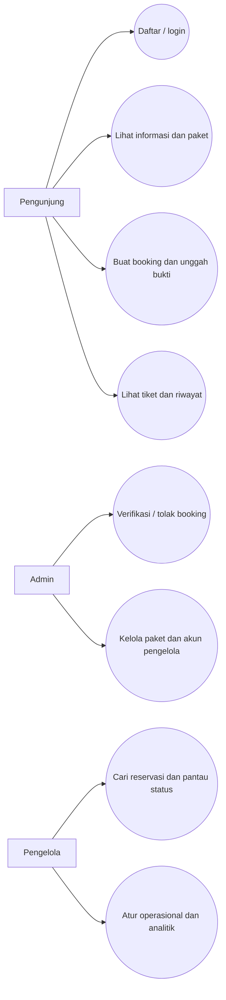
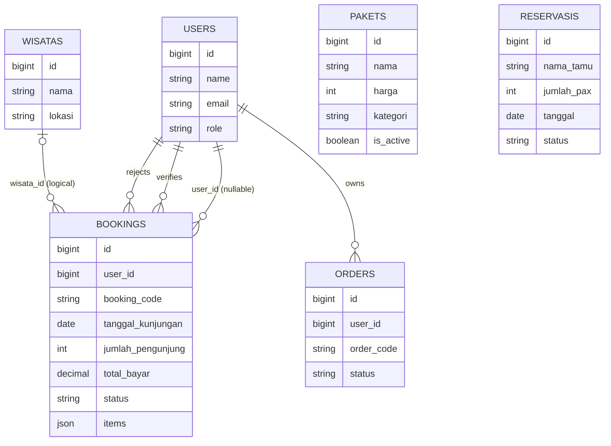

# Bahan Presentasi Sprint 4

## Slide 1 — Judul dan tim

**Sistem Booking dan Informasi Wisata Kawah Putih**  
Anggota tim: isi nama anggota dan peran aktual sebelum presentasi.

## Slide 2 — Latar belakang

- Pengunjung memerlukan cara yang jelas untuk melihat paket dan mengajukan booking.
- Admin memerlukan alur pemeriksaan bukti bayar serta pengelolaan paket.
- Pengelola memerlukan informasi reservasi dan operasional pada satu sistem.

## Slide 3 — Tujuan dan manfaat

- Menyatukan informasi wisata, katalog, dan pengajuan booking.
- Memisahkan akses pengunjung, admin, dan pengelola sesuai role.
- Membantu pengecekan pembayaran dan status kunjungan.
- Mempermudah pemeliharaan konten dan informasi operasional.

## Slide 4 — Kebutuhan pengguna

| Pengguna | Kebutuhan utama |
|---|---|
| Pengunjung | Registrasi/login, mencari paket, booking, mengirim bukti, melihat riwayat |
| Admin | Memeriksa booking, memverifikasi/menolak pembayaran, mengelola paket dan akun |
| Pengelola | Memantau reservasi, mengatur status kunjungan dan operasional, melihat analitik |

## Slide 5 — Use case dan data

Use case utama: pengunjung membuat booking; admin memverifikasi bukti; pengelola memantau reservasi dan operasi. Model data inti: `users`, `bookings`, `pakets`, `wisatas`, dan `reservasis`. Booking menyimpan item paket sebagai snapshot JSON/teks. Relasi `bookings.wisata_id` bersifat logis dan belum diberi foreign key pada migrasi.

`PAKETS` tidak memiliki foreign key langsung ke `BOOKINGS`; harga/nama item disimpan pada snapshot booking. `RESERVASIS` adalah data reservasi manual terpisah. `ORDERS` tersedia di skema/model, tetapi alur checkout yang sekarang menggunakan tabel `bookings`.

## Slide 6 — Arsitektur dan teknologi

- Laravel 12, PHP 8.2+, routing/controller/model Eloquent.
- Blade untuk halaman web; Vite/Tailwind untuk aset frontend.
- SQLite dapat dipakai untuk lokal; konfigurasi mendukung MySQL/MariaDB untuk deployment.
- Middleware autentikasi dan role membatasi panel admin/pengelola.
- File bukti pembayaran menggunakan disk publik Laravel dan tautan `storage`.

Alasan: menggunakan stack yang sudah ada pada proyek, satu aplikasi monolit yang mudah dijalankan dan dirawat untuk skala tugas ini.

## Slide 7 — Fitur utama

- Login dan dashboard berbeda berdasarkan role.
- Katalog paket wisata dan konten informasi.
- Booking dengan validasi tanggal/jumlah, metode bayar, dan unggah bukti.
- Verifikasi/penolakan booking, riwayat, pencarian reservasi, serta fitur operasional.

## Slide 8 — Implementasi

Masukkan screenshot aktual untuk:

1. Katalog paket dan formulir booking.
2. Halaman tiket/riwayat pengunjung.
3. Daftar booking admin dan tindakan verifikasi.
4. Dashboard/pencarian reservasi pengelola.

Samarkan data pribadi sebelum screenshot dipresentasikan. Bukti visual perlu diambil dari instalasi yang benar-benar akan didemokan.

## Slide 9 — Pengujian

Pemeriksaan lokal terakhir: `php artisan test` — **13 tes lulus, 49 assertions, 0 gagal**. Cakupan meliputi redirect role, login, pencarian/pagination, booking, katalog paket, halaman 404, dan penanganan kegagalan database.

Pengujian ini bukan bukti deployment eksternal atau uji beban; lakukan smoke test ulang pada lingkungan rilis.

## Slide 10 — Kendala dan pengembangan berikutnya

- Proyek adalah aplikasi booking wisata; contoh API/entitas perpustakaan pada materi Sprint 4 tidak sesuai dan telah disesuaikan dengan fitur aktual.
- Endpoint JSON yang ada hanya beberapa; fitur lainnya memakai formulir web/session, bukan API REST.
- Perlu melengkapi screenshot aktual, identitas tim, dan tujuan server sebelum presentasi final.
- Pengembangan berikutnya: API terstruktur bila dibutuhkan, monitoring operasional, dan otomasi backup/restore.

## Slide 11 — Kesimpulan

Aplikasi menyediakan alur utama pengunjung, admin, dan pengelola serta telah melewati tes otomatis lokal. Rilis publik belum dinyatakan selesai sebelum konfigurasi hosting, akun admin aman, backup, dan smoke test produksi diverifikasi.
